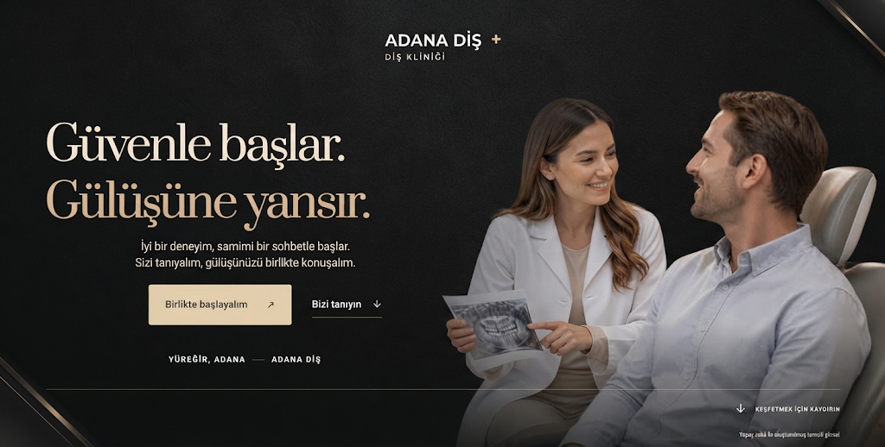

# Adana Diş Kliniği

Randevu sistemi ve yönetim paneli olan kurumsal web sitesi.

**Canlı demo:** [adanadis-klinigi.netlify.app](https://adanadis-klinigi.netlify.app/)



## Ne yapıyor?

- Ziyaretçi hizmet, hekim, tarih ve saat seçerek örnek randevu talebi oluşturur.
- Yönetici talepleri listeler, onaylar, taşır veya iptal eder.
- Takvim, hekim çalışma saatleri, izinler ve hasta notları için panel sunar.
- Masaüstü ve telefon ekranlarına uyumlu arayüz kullanır.

## Kullanılan teknolojiler

HTML, CSS, JavaScript; yerel sunucu için Python ve SQLite; statik demo yayını için Netlify. Açılış animasyonunda Motion kullanılır.

## Nasıl çalışır?

| Sürüm | Veri | Giriş |
| --- | --- | --- |
| Netlify demosu | Aynı tarayıcının localStorage alanı | Kullanıcı: **demo**, parola: **demo**; yalnız arayüz demosu |
| Yerel Python uygulaması | Bilgisayarda oluşturulan SQLite veritabanı | İlk çalıştırmada oluşturulan yerel yönetici hesabı |

Netlify demosu Python çalıştırmaz ve merkezi veritabanına bağlanmaz. Randevu ve panel aynı tarayıcıdaki örnek kayıtları kullanır; başka cihazla paylaşılmaz. Tarayıcı verileri temizlenirse demo kayıtları silinir. Gerçek hasta bilgisi girilmemelidir. Bildirim ve gerçek ödeme gönderilmez.

Yerel sürümde form API'ye istek gönderir; sunucu uygun saatleri denetleyip talebi SQLite'a yazar. Yönetici girişi, oturum ve değişiklik kontrolleri sunucuda yapılır. Bu yerel kurulum internete açılmak için hazırlanmış bir hasta sistemi değildir.

## Çalıştırma

Netlify çıktısı için Node.js 22 veya üzeri:

```sh
npm run build
```

Oluşan `netlify-site/` klasörü yayımlanır; Netlify ayarları `netlify.toml` içindedir.

Python 3.12 ile yerel API:

```sh
python server.py
```

Adres: `http://127.0.0.1:4180`, panel: `/yonetim`. Varsayılan Windows veri alanı `%LOCALAPPDATA%/OzYilmazClinic/` altındadır; yönetici bilgisi `local-admin.txt` dosyasındadır. Bu bilgiler depoya eklenmez. Eski gerçek kayıtları test amacıyla kullanmayın.

## Doğrulama

```sh
node --test hero.test.cjs
python -m unittest discover -s database -p "test_*.py" -v
```

Statik paket derlendi ve 4 açılış animasyonu testi geçti. Python paketinde 19 test geçti; HTTP bağlantısı gerektiren 22 test çalışma ortamının soket erişim kısıtına takıldı. Tam HTTP testlerinin geçtiği iddia edilmez.

## Yapay zekâ kullanımı

Yapay zekâ destekli geliştirme araçlarıyla geliştirildi. Tasarım, içerik, özellik kapsamı ve revizyonlar tarafımdan yönlendirildi; kod üretimi ve hata çözümünde bu araçlardan yararlanıldı. Aşağıdaki doğrulama notları bu GitHub sürümünün hazırlığına aittir. Klinik görselleri temsili ve yapay zekâ üretimidir.
